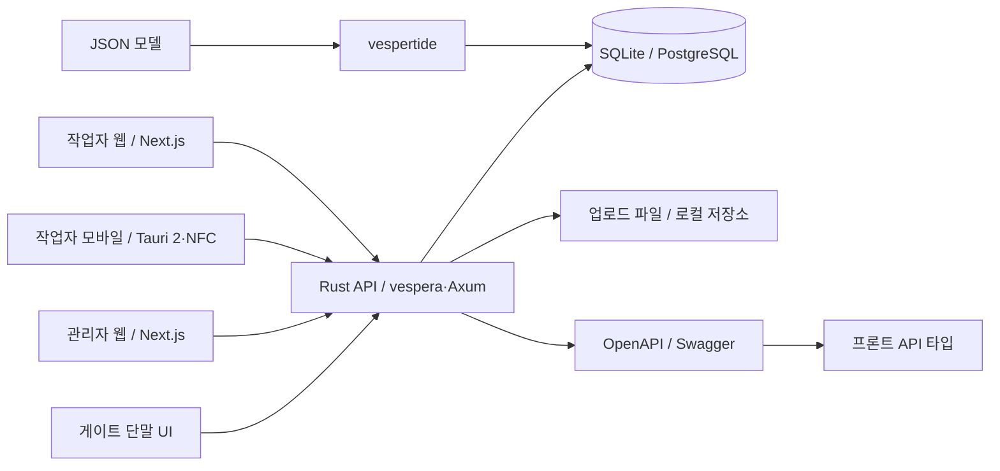

# PortSyncAI

> 항만 작업자의 안전지침 확인, 보호구 NFC 검증, 교육·작업 준비 상태와 게이트 출입 판정을 연결하는 안전관리 플랫폼입니다.

**Team Portsync** · Port × Sync — 사람, 시스템, 안전을 연결합니다.

[프로젝트](https://github.com/PortSyncAI/PortSyncAI) · [이슈](https://github.com/PortSyncAI/PortSyncAI/issues)

## 서비스 흐름

1. 관리자가 직원·작업 배정·문서 검수·보호구 요구조건·교육 정보를 준비합니다.
2. 작업자는 배정된 작업과 안전지침을 확인하고 보호구 NFC 태그를 스캔합니다.
3. 서버가 장비 상태·소유자·공용 장비 점유 등 조건을 검사합니다.
4. 게이트 단말이 사원증을 읽고 서버에 출입 판정을 요청합니다.
5. 서버가 출근·승인·작업중지 상태를 검사하고 통과 여부와 사유를 반환합니다. v2 작업 배정 ID가 전달되면 교육·PPE 준비 상태도 검사합니다.

## 핵심 기능

| 기능 | 설명 |
|---|---|
| 출근·안전지침 | 당일 출근 절차와 안전지침 확인 기록 관리 |
| 보호구 NFC 검증 | 태그 토큰을 기반으로 장비 상태·소유자·공용 장비 점유 및 중복 요청 검사 |
| 화물·문서 관리 | 화물 등록과 위험물 분류, B/L·DGD 업로드 및 검수 정보 관리 |
| 교육·작업 준비 | 교육과정·이수내역·대상규칙과 작업별 PPE 요구조건 관리 |
| 작업 배정 | 작업자 배정과 준비 정보 관리 |
| 게이트 판정 | 단말 인증과 출입 조건 검사, 통과·차단 사유 및 이력 기록 |
| 현장 운영 | 직원·부서·직무 관리, 예외 승인과 작업중지·해제 |

## 아키텍처



작업자·관리자 앱은 하나의 Rust API를 공유합니다. 모바일 앱은 작업자 웹을 Tauri로 패키징해 NFC 기능을 사용합니다. JSON 모델 정의에서 DB 마이그레이션과 SeaORM 엔티티를 생성하고, API 계약은 OpenAPI로 공유합니다.

## 기술 스택

| 영역 | 기술 |
|---|---|
| 웹 | Next.js 16 · React 19 · TypeScript 6 · devup-ui |
| 모바일 | Tauri 2 · NFC plugin |
| API | Rust 2024 edition · vespera/Axum · Tokio |
| DB | SeaORM · SQLite / PostgreSQL · vespertide |
| 인증·파일 무결성 | JWT · argon2 · SHA-256 |
| API 계약 | OpenAPI · devup-api · TypeScript 타입 |
| 개발·테스트 | Bun workspaces · oxlint · Husky · Clippy · rustfmt · Rust 통합 테스트 |
| 배포 구성 | Docker Compose · Nginx · PM2 · GitHub Actions |

## 프로젝트 구조

```text
apis/api/
  models/          JSON 스키마 원본
  migrations/      마이그레이션
  src/models/      생성된 SeaORM 엔티티
  src/routes/      도메인별 API
  src/utils/       인증·상태·시드
  tests/           인증·NFC·게이트·작업배정 통합 테스트
apps/front/        작업자 웹
  src-tauri/       모바일 셸·NFC 권한·빌드 설정
apps/admin/        관리자 웹·게이트 단말 화면
scripts/           E2E smoke 스크립트
docker-compose.yml 배포 실행 구성
Dockerfile.build   웹/API 배포 아카이브 생성
```

## 로컬 개발

Rust와 Bun이 필요합니다. 모바일 개발은 대상 플랫폼의 SDK·서명·실기기 NFC 환경이 추가로 필요합니다.

```bash
git clone https://github.com/PortSyncAI/PortSyncAI.git
cd PortSyncAI
git switch develop
bun install
```

저장소 루트에서 의존성을 설치한 뒤, 각 터미널에서 다음 명령을 실행합니다. 웹 앱의 기본 API 주소에 맞춰 서버 포트를 `18090`으로 지정합니다.

```bash
# 터미널 1: API. 시작 시 DB 마이그레이션·마스터 데이터 로딩
PORT=18090 JWT_SECRET='replace-with-your-local-secret' cargo run

# 터미널 2: 작업자 웹
bun run --cwd apps/front dev --port 3000

# 터미널 3: 관리자 웹
bun run --cwd apps/admin dev --port 3001
```

| 서비스 | 주소 |
|---|---|
| 작업자 웹 | http://localhost:3000 |
| 관리자 웹 | http://localhost:3001 |
| API | http://127.0.0.1:18090 |
| Swagger | http://127.0.0.1:18090/docs |

관리자 웹을 API와 연결하려면 `apis/api/src/main.rs`의 CORS 허용 origin에 `http://localhost:3001`을 추가하세요. API 주소를 변경할 때는 두 앱의 `src/lib/apiClient.ts`를 함께 확인하세요. 작업자 앱은 `NEXT_PUBLIC_API_BASE_URL` 환경변수를 지원합니다.

### 서버 환경변수

| 이름 | 기본값 | 용도 |
|---|---|---|
| DATABASE_URL | `sqlite:./test.db?mode=rwc` | DB 연결 |
| JWT_SECRET | 개발용 기본 문자열 | JWT 서명. 실행 환경별 값 주입 필요 |
| UPLOAD_DIR | `./uploads` | 업로드 저장 경로 |
| PORT | `8000` | API 포트 |

서버는 프로세스 환경변수를 읽습니다. 로컬 `cargo run`은 `apis/api/.env`를 자동 로딩하지 않으므로 셸에서 주입해야 합니다. Compose는 해당 파일을 `env_file`로 읽습니다. SQLite 파일과 업로드 상대 경로는 실행 디렉터리를 기준으로 합니다.

### Docker 배포 구성

Docker 배포는 `Dockerfile.build`로 생성한 `front.tar.gz`, `api.tar.gz`를 실행용 이미지에 전달하는 방식입니다. Compose 실행 전 두 아카이브와 `apis/api/.env`를 준비하세요.

배포 전 Nginx 관리자 TLS 설정, 포트·API 주소·CORS, DB와 업로드 영속 볼륨을 환경에 맞게 정리해야 합니다. PostgreSQL은 별도로 제공해야 합니다.

## 모바일·NFC

작업자 웹 앱을 Tauri 모바일 셸로 패키징합니다. 웹용 Next.js는 standalone 출력, Tauri 빌드는 static export를 사용합니다.

```bash
cd apps/front
bun run build:tauri
# 대상 플랫폼 SDK를 준비한 후
bun run tauri:android:init
bun run tauri:android:dev
```

NFC 스캔에는 NFC를 지원하는 모바일 기기와 앱 권한이 필요합니다. 태그 토큰은 서버의 보호구 등록 정보와 연결해 사용합니다.

## API와 DB 개발

전체 API 계약은 서버의 `/docs`에서 확인합니다. OpenAPI는 `apps/front/openapi.json`, `apps/admin/openapi.json`에 출력되며 클라이언트 타입과 맞춰 관리해야 합니다.

주요 도메인: 인증, 직원·조직, 출근·안전지침, 화물·문서 검수, 교육, PPE 요구조건, 작업 배정·준비, NFC 태그, 승인·작업중지, 게이트 단말·판정.

```bash
cargo install vespertide-cli
cd apis/api
# models/*.json 수정 후
vespertide revision -m "변경 설명"
vespertide export --orm seaorm
```

`src/models/`는 생성 파일이므로 직접 수정하지 않습니다. 모델 원본과 마이그레이션을 함께 관리하고 FK 컬럼은 `_id` 규칙을 따릅니다.

## 검증

```bash
cargo fmt --check
cargo clippy -- -D warnings
cargo test
bun run lint
bun run build
```

루트 `bun run test`는 Bun 테스트 후 cargo-tarpaulin으로 Rust 커버리지를 수집합니다. API 통합 테스트는 `apis/api/tests/`, E2E 스모크 스크립트는 `scripts/e2e-smoke.mjs`에서 관리합니다.

## 협업 규칙

- 개발 기준 브랜치: `develop`.
- 브랜치: `feature/*`, `fix/*`, `docs/*`, `test/*`, `refactor/*`.
- 이슈 → 작업 브랜치 → 커밋에 이슈 번호 → PR에 `Closes #번호` → 검토·병합.
- 커밋: `타입: 요약 (#이슈번호)`.
- 주석은 비즈니스 정책·보안 경계·기술적 제약의 이유를 설명합니다. 후속 작업은 이슈로 추적합니다.
